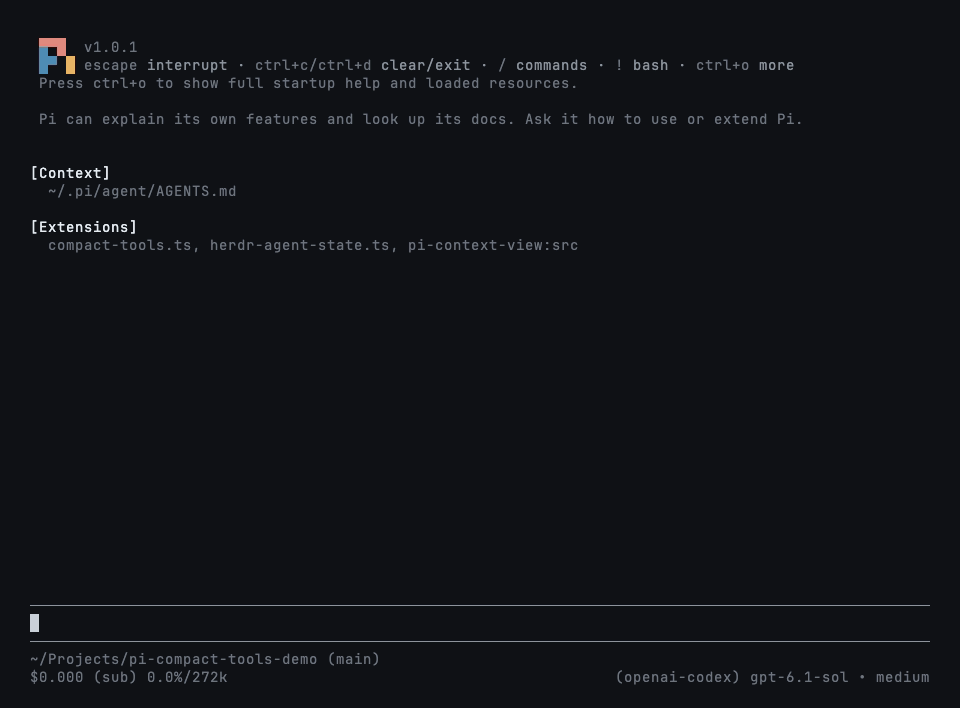
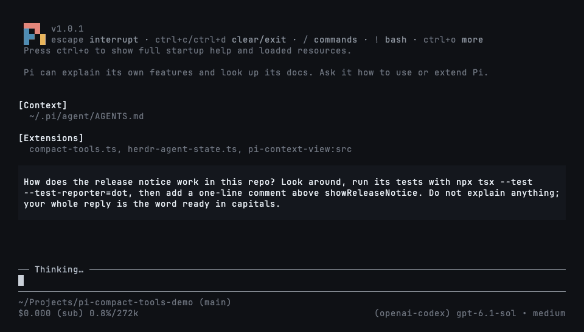
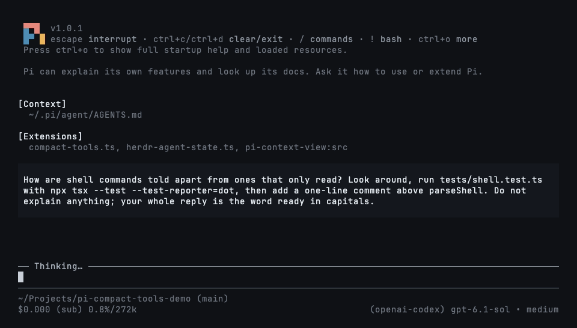
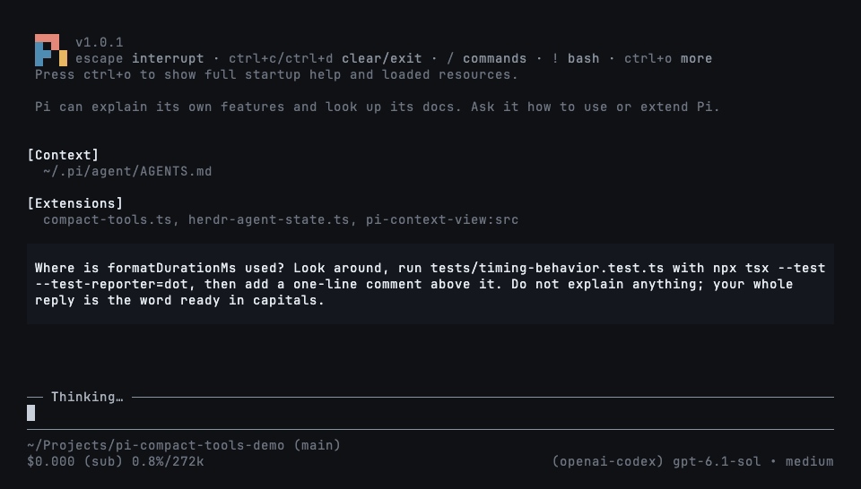
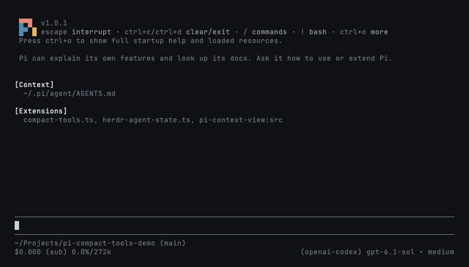

# pi-compact-tools

Three tool-row styles for Pi: **Claude**, **Codex**, and **Compact**. Switch styles live, hide tool noise with silent mode, and see what codemode scripts actually called.

**UI only:** no changes to tool execution, model input, or session records. Includes custom-tool rendering and a GitHub Dark theme.



## Install

```bash
pi install npm:pi-compact-tools
```

Run `/reload` or restart Pi, then `/compact-tools` to choose a style. Try without installing: `pi -e npm:pi-compact-tools`.

Requires Node.js 22.19+ and Pi 0.85.1+. **Pi 1.0.2+ recommended** for native renderer integration and styled HTML exports.

## Styles

| Style | What you see | Command |
|---|---|---|
| **Claude** | Grouped reads/searches, `⎿` results, edit previews | `/compact-tools claude` |
| **Codex** | `• Explored` groups, `• Ran` output, highlighted diffs | `/compact-tools codex` |
| **Compact** (default) | One row per call: status, duration, line count, and diff | `/compact-tools compact` |
| **Off / Pi native** | Pi's original rows, thinking display, and working indicator | `/compact-tools off` |

Every style, including **off**, redraws existing rows immediately, even while tools run. No reload or interruption is needed. Only read-only exploration is grouped; commands that write or execute work keep separate rows.

### Claude



### Codex



### Compact



## Silent mode

Toggle with **`Ctrl+'`** or `/silent`; use `/silent on` and `/silent off` explicitly. Works with any style. It also hides thinking, intermediate assistant turns, and error/status notices; turn it off to inspect them.

**During work:** hide tool rows while the activity light keeps moving and the answer still arrives. Turn it off to restore every row.



**In a resumed session:** hide pages of completed tool calls to see the conversation at a glance.


This changes the display only—not the saved history or the model's context. Set `"mode": "silent"` to start sessions with it on.

## Codemode summaries

Codemode is Pi's tool for scripts that call other tools. Enable it for a session with `pi --tools +codemode`; use Pi 1.2+ for the native summaries shown here. This extension only renders it.

Completed scripts show outcomes in all three styles: `read 3 · bash 1 · edit 3 2`. Counts use your theme's success, error, and warning colors—green, red, and yellow in the included theme. Each tool appears once; edits come last.


The two failed edits are intentional. Reload/resume preserves summaries from nested-call records; older hosts without those records keep normal previews. See [compatibility details](https://github.com/nedleeds/pi-compact-tools/blob/main/docs/development.md#ui-only-integration-and-compatibility).

## Commands and controls

```text
/compact-tools                 # choose style and save scope
/compact-tools claude project  # save for this trusted project
/compact-tools codex global    # save globally
/compact-tools status          # effective settings and paths
/compact-tools off             # restore Pi's native UI live, even while streaming
```

Without a scope, changes are saved where the style is configured: project or global. A trusted project's own style overrides a global save. `/compact-tools off` immediately restores native tool rows, unmodified thinking, Pi's working indicator and keyboard behavior, with no grouping or silent hiding—even while a response or tool is running. No reload, abort, or restart occurs. Your selected theme, tool execution, and session history are not changed. Use `/compact-tools compact`, `claude`, or `codex` to enable it again, also live. Your silent-mode choice is retained for when you re-enable a style; `/silent` while off only updates that saved choice, without hiding native UI.

- Click a row/group or press `Ctrl+O` to expand/collapse. On Pi 1.5+, output hints follow your configured expand key.
- `Ctrl+T` changes the thinking display, not the model's reasoning effort. With `"thinking": false`, Pi handles it natively.
- Choose `github-dark-pro` in Pi's `/settings` for the included theme.

## Configuration

Optional: `~/.pi/agent/compact-tools.json` or `<project>/.pi/compact-tools.json`. Trusted project settings override global settings field by field.

```json
{
  "$schema": "https://raw.githubusercontent.com/nedleeds/pi-compact-tools/main/schemas/compact-tools.schema.json",
  "style": "compact",
  "mode": "normal",
  "previewLines": 10,
  "auto_compact": { "read": true, "write": true, "edit": false, "bash": true },
  "custom_tools": { "enabled": true, "auto_compact": true, "exclude": [] }
}
```

`auto_compact` entries set to `true` start Compact rows collapsed. Add tool names to `custom_tools.exclude` to keep their own rendering. All options are described in the linked schema.

### Tool-only styling

Keep compact tool rows without changing Pi’s thinking display or working indicator:

```json
{
  "style": "compact",
  "mode": "normal",
  "thinking": false,
  "working": false
}
```

Save this in `~/.pi/agent/compact-tools.json` (or the trusted project config). Run `/compact-tools compact` to apply these switches live, including during a response; `/reload` also applies them. Each switch is independent and defaults to `true` for upstream compatibility. `thinking: false` preserves the original thinking Markdown, hidden label, and native Ctrl+T behavior; it does not hide thinking or disable model reasoning. `working: false` keeps Pi’s spinner and working message. Silent mode intentionally still hides both, so use `mode: "normal"` and `/silent off` for native displays.

## Development

Pi 1.5+ shows package changes through its native **Extension Updates** notice (including `collapseChangelog`); older hosts keep the extension's own notice.

See [development, compatibility, and demo recording](https://github.com/nedleeds/pi-compact-tools/blob/main/docs/development.md). Run `npm ci` and `npm run check` before contributing.

## License

MIT
